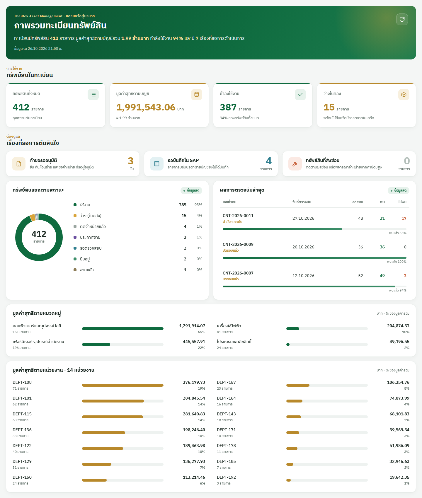

# ThaiBev Executive Asset Dashboard

ปลั๊กอินมุมมอง (Custom View) สำหรับแอป **ThaiBev Asset Management** บน Nocoly
แสดงภาพรวมทะเบียนทรัพย์สินสำหรับผู้บริหาร ใช้ในหน้า Page "Executive Dashboard"



> ภาพนี้ใช้ **ข้อมูลตัวอย่างที่สร้างขึ้นเอง** ไม่ใช่ข้อมูลจริงของ ThaiBev (ดู [preview/](preview/))

## แสดงอะไรบ้าง

| ส่วน | ข้อมูล | คำนวณจาก |
|---|---|---|
| แถบหัว | สรุปหนึ่งประโยค + เวลาที่ดึงข้อมูล + ปุ่มรีเฟรช | ทุกส่วนด้านล่าง |
| ทรัพย์สินในทะเบียน | ทั้งหมด, มูลค่าสุทธิตามบัญชี, กำลังใช้งาน, ว่างในคลัง | ตาราง **ทะเบียนทรัพย์สิน** |
| เรื่องที่รอการตัดสินใจ | คำขอรออนุมัติ, รอบันทึกใน SAP, ส่งซ่อม | ตาราง **ใบคำขอ**, **รายการปรับปรุง SAP**, ทะเบียน |
| ทรัพย์สินแยกตามสถานะ | กราฟโดนัท + จำนวน/% ทุกสถานะ | ช่อง "สถานะทรัพย์สิน" |
| ผลการตรวจนับล่าสุด | 5 รอบล่าสุด: ควรพบ / พบ / ไม่พบ / % ที่พบ (คลิกเพื่อเปิดรอบ) | ตาราง **รอบตรวจนับ** |
| มูลค่าสุทธิตามหมวดหมู่ | มูลค่า (บาท) + % ของมูลค่ารวม | ช่อง "หมวดทรัพย์สิน" |
| มูลค่าสุทธิตามหน่วยงาน | ทุกหน่วยงาน เรียงจากมูลค่ามากไปน้อย | ช่อง "หน่วยงานผู้ครอบครอง" |

ข้อมูลดึงสดทุกครั้งที่เปิดหน้าหรือกดรีเฟรช รองรับจอมือถือ

## ติดตั้งอยู่ที่ไหนใน Nocoly

- ปลั๊กอินติดอยู่ในมุมมอง **Custom View** ของตาราง **Executive Dashboard** (ซ่อนจากเมนู)
  ตารางนี้ไม่มีข้อมูล ใช้เป็นที่ติดปลั๊กอินเท่านั้น — **ห้ามลบ**
- หน้า Page "Executive Dashboard" ฝัง component **View** ที่ชี้มาที่มุมมองนี้
- ผู้ชมต้องมีสิทธิ์ **ดู** ตาราง Executive Dashboard, ทะเบียนทรัพย์สิน, ใบคำขอ, รายการปรับปรุง SAP และรอบตรวจนับ
  (ซ่อนจากเมนูได้ แต่อย่าปิดสิทธิ์ดู ไม่อย่างนั้นตัวเลขส่วนนั้นจะขึ้น "—")

## ปลั๊กอินหาข้อมูลอย่างไร

ปลั๊กอินไม่ได้ผูก ID ตารางหรือช่องไว้ในโค้ด แต่หาเองตอนรัน:

1. **ตาราง** — หาจากชื่อในแอป เช่น "ทะเบียนทรัพย์สิน", "ใบคำขอ", "รายการปรับปรุง SAP", "รอบตรวจนับ"
2. **มุมมอง** — เลือกมุมมองที่ไม่มี filter และไม่จัดกลุ่ม เพื่อให้ได้ทุกแถว
   (มุมมองแบบ "ทรัพย์สินของฉัน" หรือแบบจัดกลุ่มจะให้ตัวเลขผิด)
3. **ช่อง** — หาจากชื่อ เช่น "มูลค่าสุทธิ", "สถานะทรัพย์สิน" ถ้าหลายช่องชื่อคล้ายกัน เลือกช่องที่มีข้อมูลมากที่สุด
4. **การนับสถานะ**
   - กำลังใช้งาน = สถานะ "ใช้งาน" หรือ "ยืม"
   - ว่างในคลัง = "ว่าง" / "คลัง"
   - คำขอรออนุมัติ = สถานะใบคำขอมีคำว่า "รออนุมัติ"
   - รอบันทึก SAP = สถานะขึ้นต้นด้วย "รอ"

   กฎทั้งหมดอยู่ที่ [src/constants.js](src/constants.js)

ถ้าเปลี่ยนชื่อตารางหรือช่องใน Nocoly แล้วตัวเลขผิด ให้ระบุ ID ตรงๆ ผ่าน **Env Param** ได้ (ดูด้านล่าง)

## Env Param

ตั้งที่ Custom View → Development → **Env Param** (รูปแบบ JSON) ทุกค่าไม่บังคับ

| พารามิเตอร์ | ใช้ทำอะไร |
|---|---|
| `assetSheet`, `requestSheet`, `sapSheet`, `countSheet` | ID ตาราง (แทนการหาจากชื่อ) |
| `assetView`, `requestView`, `sapView`, `countView` | ID มุมมองที่จะดึงข้อมูล |
| `valueField`, `statusField`, `categoryField`, `deptField` | ID ช่องในตารางทะเบียน |
| `debug` | `true` = แสดงกล่อง "แหล่งข้อมูล" บอกว่าดึงจากตาราง/มุมมอง/ช่องไหน ได้กี่แถว และ error อะไร |

ตัวอย่าง:

```json
{ "assetSheet": "<ID ตารางทะเบียนทรัพย์สิน>", "debug": true }
```

## พัฒนาและอัปเดต

ต้องมี Node.js 16.20+ และ `mdye-cli` (`npm install -g mdye-cli`)

```bash
npm install

# พัฒนา: เปิดเซิร์ฟเวอร์บนเครื่อง แล้วใส่ http://localhost:3000/bundle.js
# ในช่อง Custom View → Development (เห็นเฉพาะเครื่องตัวเอง, ต้องรันค้างไว้)
mdye start

# ปล่อยให้ทุกคนใช้
mdye build
mdye push -m "อธิบายสิ่งที่แก้"
# แล้วไปที่ Custom View → Submission → Publish เวอร์ชันใหม่
# และลบ URL localhost ออกจากช่อง Development
```

`mdye push` แค่อัปโหลดเป็นฉบับร่าง ผู้ใช้จะเห็นของใหม่ก็ต่อเมื่อกด **Publish** แล้ว

## โครงสร้างโค้ด

```
src/
├── App.js                 เลย์เอาต์ของแดชบอร์ด
├── styles.js              CSS ทั้งหมด (styled-components)
├── constants.js           สี, ชนิดช่อง, กฎจับคู่สถานะ
├── hooks/useDashboard.js  โหลดข้อมูล, รีเฟรช, ฟัง event จาก Nocoly
├── data/loaders.js        หาตาราง/มุมมอง แล้วดึงข้อมูลแต่ละตาราง
├── data/stats.js          หาช่องในทะเบียน และคำนวณตัวเลข
├── utils/fields.js        แปลงค่าช่องของ Nocoly เป็นข้อความ/ตัวเลข
├── utils/format.js        จัดรูปแบบตัวเลขและวันที่
└── components/            การ์ด, กราฟ, ตารางรอบตรวจนับ, กล่องแหล่งข้อมูล
preview/                   หน้าทดลองนอก Nocoly ด้วยข้อมูลตัวอย่าง
docs/preview.png           ภาพตัวอย่างใน README
```

## อัปเดตภาพตัวอย่าง

[preview/](preview/) จำลอง API ของ Nocoly ด้วยข้อมูลตัวอย่าง ([preview/mock-nocoly.js](preview/mock-nocoly.js))
เพื่อเปิดแดชบอร์ดนอก Nocoly ได้ หลังแก้ UI ให้ build แล้วถ่ายภาพใหม่:

```bash
mdye build
"C:/Program Files/Google/Chrome/Application/chrome.exe" --headless=new --hide-scrollbars \
  --window-size=1440,1700 --virtual-time-budget=8000 \
  --screenshot="docs/preview.png" "file:///<path-to-repo>/preview/index.html"
```

หรือเปิด `preview/index.html` ในเบราว์เซอร์ตรงๆ เพื่อดูหน้าตา
